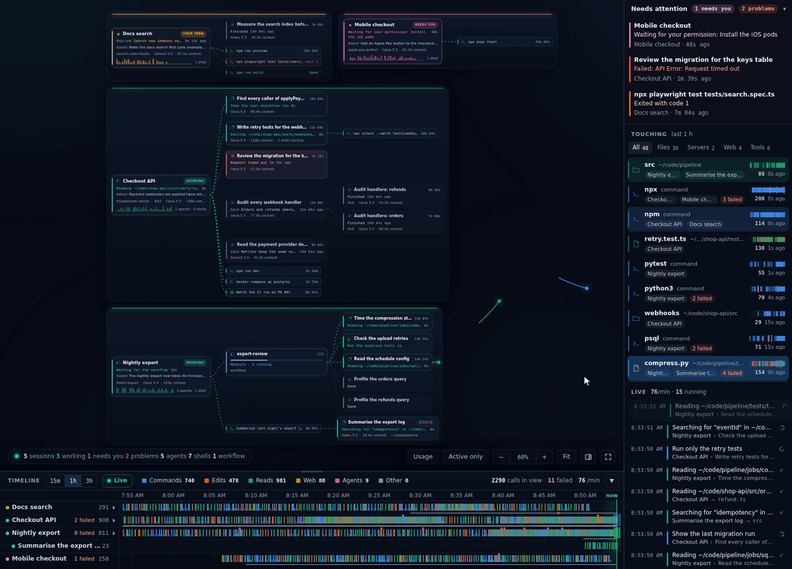
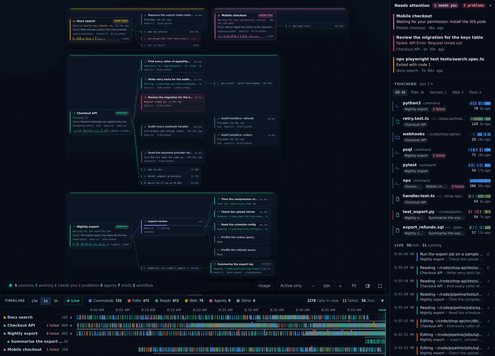
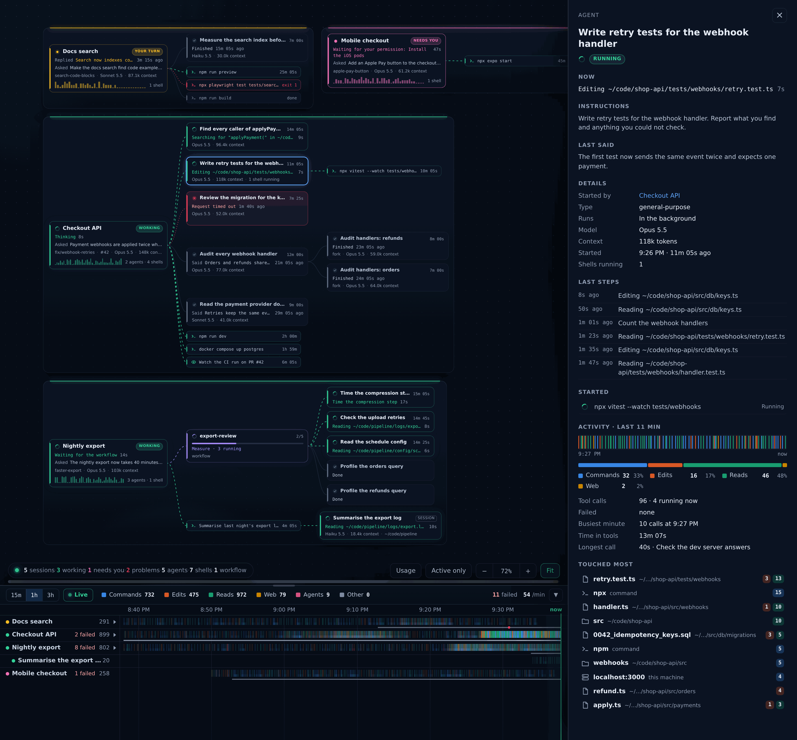
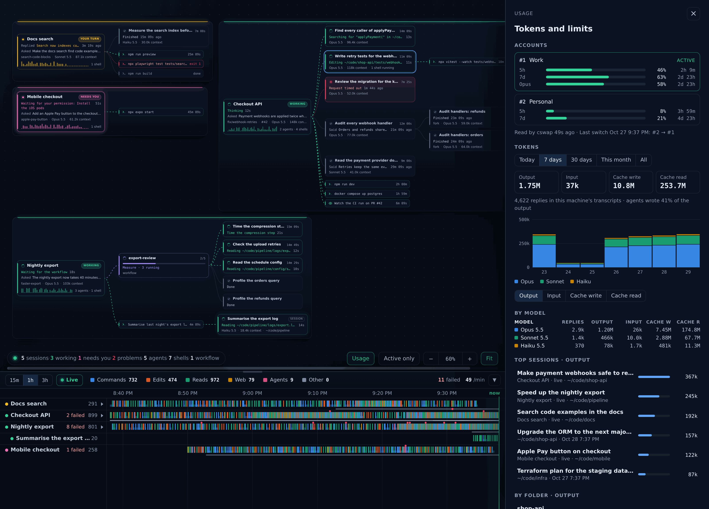

# claude-overview

**See every Claude Code session on your machine at once, and which one is waiting on you.**

[](https://www.npmjs.com/package/claude-overview)


Running a few Claude Code sessions at once, and one has been sitting on a permission prompt while you worked in
another window? claude-overview puts every session on one live board in your browser and shows which one needs you.



```
npx claude-overview
```

Then open http://127.0.0.1:3100/. It runs until you press Ctrl + C.

## What you get

- **Which session needs you.** A session waiting for your permission or an answer turns pink, and the tab title
  counts the sessions that are waiting.
- **Desktop alerts** when a session needs you or something fails, while the page is open but not in front.
- **Everything a session runs:** its agents, workflows and background shells, and what each one is doing now.
- **A timeline of every tool call**, over the last 15 minutes, hour or 3 hours, or live.
- **What each session is touching:** the files, servers and sites it works with.
- **Token usage:** totals by day, model, session and folder, and the plan limits of each account with cswap.
- **No tokens, no changes:** it only reads files Claude Code already writes.

## Requirements

- Linux, WSL or macOS. macOS support has not been tested on a real Mac yet.
- [Node.js](https://nodejs.org) 20 or later. It has no npm dependencies.
- Claude Code, in VS Code or in the terminal.
- Optional: [cswap](https://github.com/realiti4/claude-swap), to show the plan limits of each account.

## More ways to run it

- `npm install -g claude-overview` keeps it installed, so `claude-overview` starts it.
- Or clone this repository and run `./overview start` in its folder to start it in the background.
  `./overview status` and `./overview stop` check on it and stop it.
- To use another port, set `CLAUDE_OVERVIEW_PORT` before starting it.
- It does not start again by itself after a restart.

## Using it

| Key or action | What it does |
| --- | --- |
| Scroll, or drag | Moves around the board. Shift + scroll moves sideways. |
| Ctrl + scroll, a pinch, Ctrl + and Ctrl - | Zoom. Command instead of Ctrl on a Mac. |
| F | Fits the board to the window: all of it when it fits at a size you can read, otherwise the window's width. |
| 0 | Full size. |
| Shift + F | Full screen. So does the button at the bottom right. |
| S | Hides or shows the right-hand column, in a window wide enough to have one. |
| Click a card | Shows what it is doing, what it has touched and what failed. |
| The timeline | Every tool call over the last 15m, 1h or 3h, or Live. T folds it away and L goes back to Live. |
| Usage, or U | Token totals by day, model, session and folder, and the plan limits of each cswap account. |

The bell in the bottom row turns on desktop alerts. They show while the page is open but not in front: a session
needs you, something fails or stops and, if you tick it, a session finishes its turn. Clicking an alert opens that
card. An alert can quote an error or what the session last said, so it can show on your lock screen. The bell is
hidden on a phone-sized screen.

A reload keeps how you left it: the zoom (and the scroll, in a window of the same size), the open panel, expanded
groups, the timeline and the right-hand column.







The demo and the screenshots show made-up projects.

## What it reads

- `~/.claude/sessions` (or `$CLAUDE_CONFIG_DIR/sessions`), to see which sessions are running.
- The session, agent and workflow transcripts under `~/.claude/projects`.
- The process list, to find background shells: `/proc` on Linux, `ps` and `lsof` on macOS.
- cswap's account list and usage cache, when cswap is installed. Never its credentials.

It never changes any of them. The server listens on 127.0.0.1 only and answers only GET requests. Token totals are
kept in `~/.local/state/claude-overview` (`$XDG_STATE_HOME/claude-overview` when that is set, and
`~/Library/Application Support/claude-overview` on macOS); the first start reads your whole transcript history once, at
low priority.

Token totals come from the transcripts on this machine. Runs started with `claude -p --no-session-persistence`
write no transcript, so they are not counted.

## Contributing

Bug reports and ideas are welcome in [Issues](https://github.com/ManthanVasani/claude-overview/issues), and so are
pull requests. There is no build step: `node server.js` in a clone runs your copy.

## License

MIT, see [LICENSE](LICENSE). The bundled `vendor/d3.min.js` is [d3](https://d3js.org) under its own ISC license,
in [vendor/d3-LICENSE](vendor/d3-LICENSE).

claude-overview is an independent project. It is not made, endorsed or supported by Anthropic.
