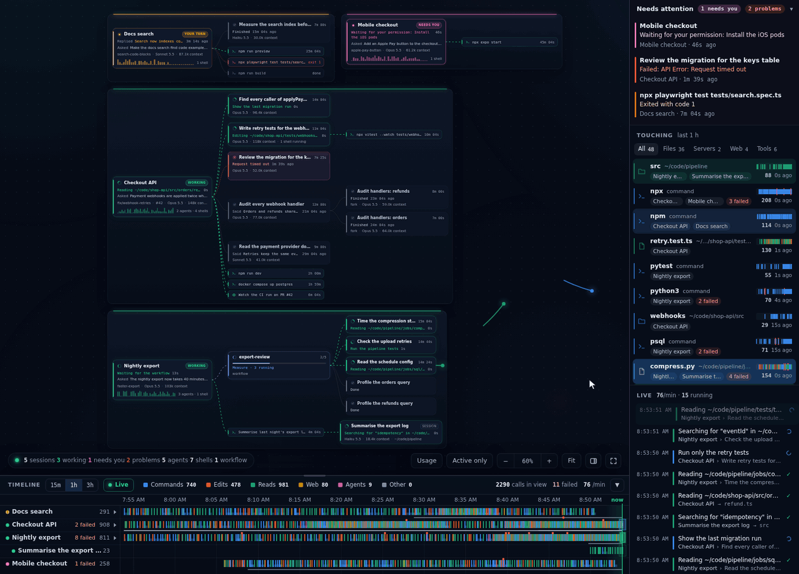
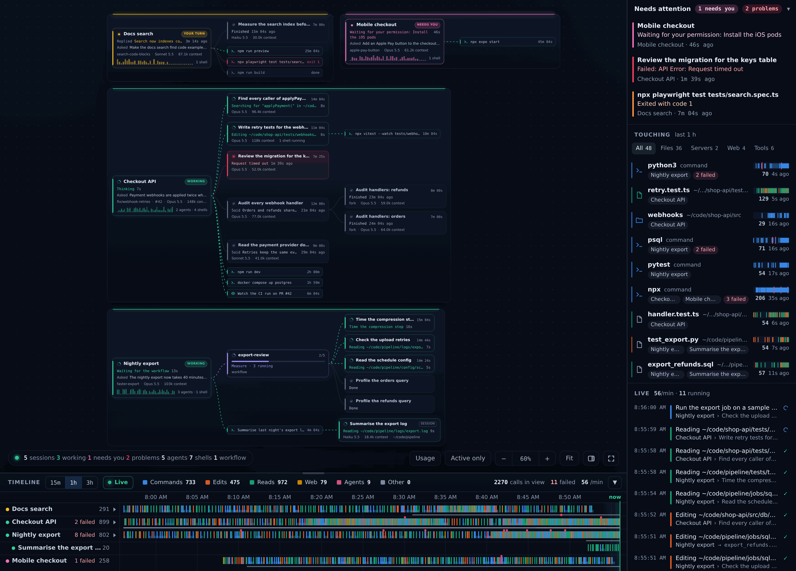
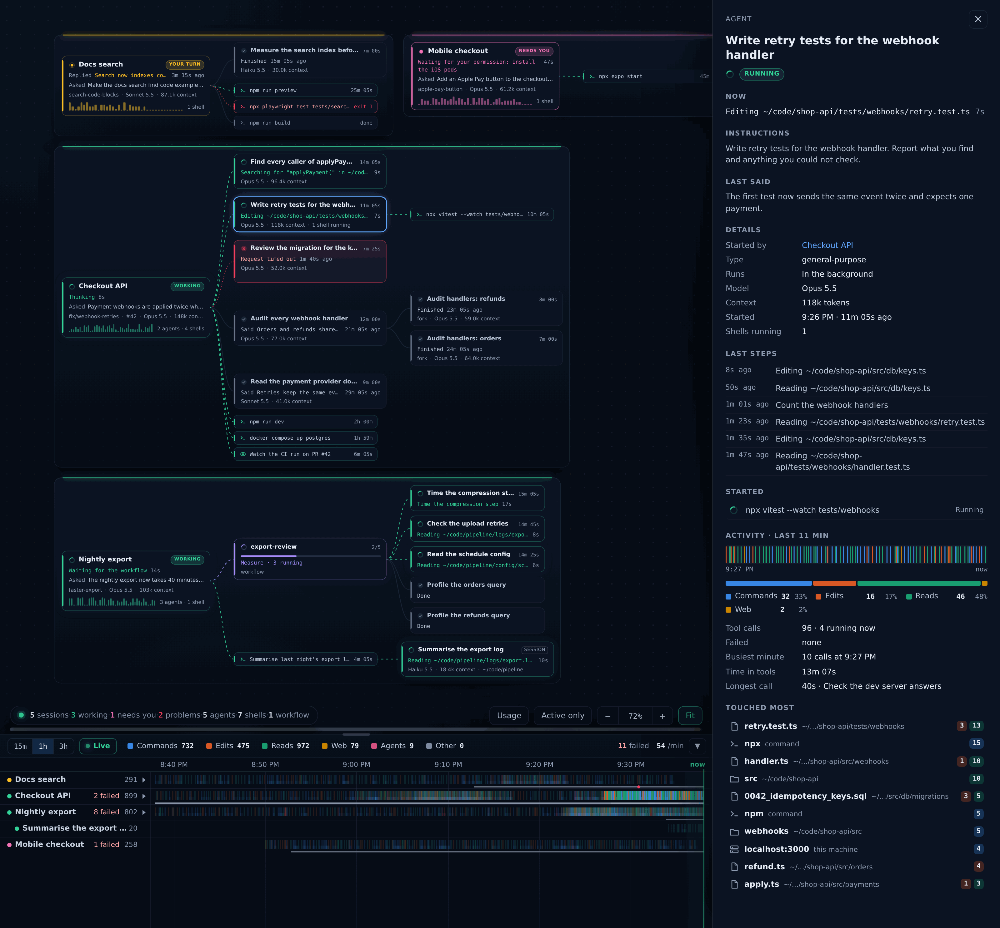
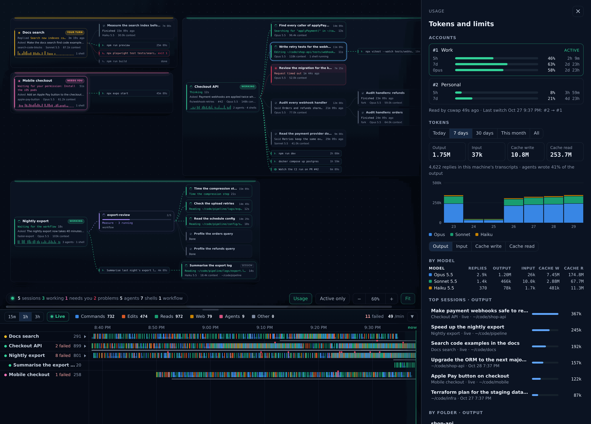

# claude-overview

**See every Claude Code session on your machine at once, and which one is waiting on you.**

[](https://www.npmjs.com/package/claude-overview)


Running a few Claude Code sessions at once, and one has been sitting on a permission prompt while you worked in
another window? claude-overview puts every session on one live board in your browser and shows which one needs you.



## What you get

- **Which session needs you.** A session waiting for your permission or an answer turns pink, and the tab title
  counts the sessions that are waiting.
- **Desktop alerts** when a session needs you or something fails, while the page is open but not in front. Turn them
  on with the bell button.
- **Everything a session runs:** its agents, workflows and background shells, and what each one is doing now.
- **A timeline of every tool call**, over the last 15 minutes, hour or 3 hours, or live.
- **What each session is touching:** the files, servers and sites it works with.
- **Token usage:** totals by day, model, session and folder. If you switch between Claude accounts with
  [cswap](https://github.com/realiti4/claude-swap), also how much of each account's plan limits is used.
- **No tokens, no changes:** it only reads files Claude Code already writes.

## Getting started

You need:

- Linux, macOS, or Windows with WSL (Windows Subsystem for Linux). On Windows, run the commands below in a WSL
  terminal. macOS support has not been tested on a real Mac yet.
- [Node.js](https://nodejs.org) 20 or later. `node --version` shows the version you have. On Windows, install it
  inside WSL (the Linux instructions on nodejs.org), not with the Windows installer.
- Claude Code, in the terminal or in VS Code. There is nothing to set up in it.

Start it in a terminal:

```
npx claude-overview@latest
```

The first time, npx asks `Ok to proceed? (y)`: press y and Enter. When it prints
`Claude overview on http://127.0.0.1:3100/`, open that address in your browser.

Keep that terminal open: the board runs there until you press Ctrl + C or close it.

## Next time

Run the same command again and open the same address:

```
npx claude-overview@latest
```

If the terminal where it runs is still open, it is still running: just open http://127.0.0.1:3100/ again. It keeps
its token totals between runs.

## Updating

Nothing to do: `npx claude-overview@latest` starts the newest version each time you start it. If it is running,
stop it with Ctrl + C and start it again. Installed it with npm or cloned it? See
[Other ways to run it](#other-ways-to-run-it).

## Other ways to run it

### Install it with npm

```
npm install -g claude-overview
claude-overview
```

Next time, run `claude-overview`. To update it, run `npm install -g claude-overview@latest`, then stop it with
Ctrl + C and start it again: until then the copy already running cannot find its page.

### Keep it running in the background

This way it keeps running after you close the terminal. It needs git. The first time, get a copy in your home
folder and start it (there is nothing to install):

```
cd ~
git clone https://github.com/ManthanVasani/claude-overview.git
cd claude-overview
./overview start
```

Next time, in that folder (`cd ~/claude-overview`):

- `./overview start` starts it. When it is already running, it only says so.
- `./overview status` says whether it is running.
- `./overview stop` stops it.

The board's own messages, errors included, go to `overview.log` in that folder. It does not start again by itself
after you restart the computer. On WSL, it stops when WSL does, which can be soon after the last WSL window closes.

To start it whenever you open a terminal, add this line at the end of `~/.bashrc` (bash, the usual shell on Linux and
WSL) or `~/.zshrc` (zsh, the default on macOS):

```
~/claude-overview/overview start > /dev/null
```

To update it, in that folder:

```
./overview stop
git pull
./overview start
```

If `start` says it is already running, the old copy is still closing: run `./overview start` again a moment later.

### Use another port

Set `CLAUDE_OVERVIEW_PORT` when you start it, then open that port:

```
CLAUDE_OVERVIEW_PORT=3200 npx claude-overview@latest
```

If the port is already in use, it stops and says so (in the background, in `overview.log`). Often that is the board
itself, already running: open its address.

## Using it

Each session is a card. What it started branches off to its right: its agents, workflows and background shells, each
with what it is doing now. A session card says **Working** (green), **Your turn** (amber: it has finished and waits
for your next message), **Needs you** (pink: it waits for your permission or an answer) or **Stopped** (red: an error
ended its turn). The column on the right lists what needs attention, the files, servers and sites the sessions are
touching, and each tool call as it happens. The timeline runs along the bottom.

| Key or action | What it does |
| --- | --- |
| Scroll, or drag | Moves around the board. Shift + scroll moves sideways. |
| Ctrl + scroll, a pinch, Ctrl + and Ctrl - | Zoom. Command instead of Ctrl on a Mac. |
| F | Fits the board to the window: all of it when it fits at a size you can read, otherwise the window's width. F again goes to full size. |
| 0 | Full size. |
| Shift + F | Full screen. So does the button at the bottom right. |
| S | Hides or shows the right-hand column, in a window wide enough to have one. |
| Active only | Hides finished agents, shells and workflows. |
| Click a card | Shows what it is doing, what it has touched and what failed. Esc closes it. |
| The timeline | Every tool call over the last 15m, 1h or 3h. Drag it to look further back; Live, or L, comes back to now. T folds it away. |
| Usage, or U | Token totals by day, model, session and folder, and the plan limits of each cswap account. |

To turn on desktop alerts, click the bell button in the bottom row and turn on the switch in its menu. The first
time, the browser asks whether the page may show notifications: allow it. Alerts show while the page is open but not
in front: when a session needs you, when something fails or stops and, if you tick that option in the bell's menu,
when a session finishes its turn. Clicking an alert opens that card. An alert can quote an error or what the session
last said, and your system may show alerts on the lock screen. The bell is hidden on a phone-sized screen.

A reload keeps how you left it: the zoom (and the scroll, in a window of the same size), the open panel, expanded
groups, the timeline and the right-hand column.







The demo and the screenshots show made-up projects.

## If a session does not show

claude-overview shows the Claude Code sessions running on the same machine. If the board says "No Claude sessions
are running." or a session is missing:

- On Windows, it has to run in WSL. It sees the sessions running in WSL (in a WSL terminal, or in VS Code connected
  to WSL), not the ones running on Windows itself.
- Sessions running on another machine or in a container, such as over SSH, in a dev container or in the cloud, do
  not show.
- It reads `~/.claude`, where Claude Code keeps its files. If you set `CLAUDE_CONFIG_DIR` for Claude Code (most
  people do not), start claude-overview with the same value, such as
  `CLAUDE_CONFIG_DIR=/that/folder npx claude-overview@latest`.

## What it reads

- `~/.claude/sessions` (or `$CLAUDE_CONFIG_DIR/sessions`), to see which sessions are running and whether each is
  working, waiting for you or idle.
- The session, agent and workflow transcripts under `~/.claude/projects`.
- The process list, to find background shells: `/proc` on Linux, `ps` and `lsof` on macOS.
- cswap's account list and usage cache, when cswap is installed. Never its credentials.

It never changes any of them. The server listens on 127.0.0.1 only and answers only GET requests. Token totals are
kept in `~/.local/state/claude-overview` (`$XDG_STATE_HOME/claude-overview` when that is set, and
`~/Library/Application Support/claude-overview` on macOS); the first start reads your whole transcript history once, at
low priority, and the totals stay low until it finishes.

Token totals come from the transcripts on this machine. Runs started with `claude -p --no-session-persistence`
write no transcript, so they are not counted.

## Contributing

Bug reports and ideas are welcome in [Issues](https://github.com/ManthanVasani/claude-overview/issues), and so are
pull requests. There is no build step: `node server.js` in a clone runs your copy.

- `server.js` starts the board.
- `lib/` is the server, a module per job: reading the session registry and transcripts (`sessions`,
  `conversation`, `agents`, `workflows`), the process list (`procs`, `shells`, `shell-line`), the tool-call timeline
  (`steps`, `tools`), token usage (`usage`, `usage-scan`), serving the page and its live updates (`http`, `feed`),
  and what they share (`config`, `constants`, `files`, `text`, `log`).
- `public/` is the page and its scripts.

## License

MIT, see [LICENSE](LICENSE). The bundled `public/vendor/d3.min.js` is [d3](https://d3js.org) under its own ISC
license, in [public/vendor/d3-LICENSE](public/vendor/d3-LICENSE).

claude-overview is an independent project. It is not made, endorsed or supported by Anthropic.
